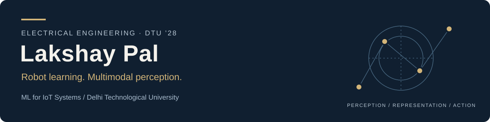

  

  <a href="https://www.linkedin.com/in/lakshaypal01/">LinkedIn</a> &nbsp; / &nbsp;
  <a href="mailto:llakshaydev@gmail.com">Email</a> &nbsp; / &nbsp;
  <a href="#selected-work">Selected work</a> &nbsp; / &nbsp;
  <a href="#experiment-artifacts">Experiment artifacts</a>

I'm an **Electrical Engineering undergraduate at Delhi Technological University, Class of 2028**, specialising in **Machine Learning for IoT Systems**.

I want to work on the decision-making side of robotics: how a system turns sensor observations and language into useful actions. My current projects cover 3D reconstruction and traversability analysis, multimodal representations, visual grounding and self-supervised learning. I'm building towards **reinforcement learning for navigation and path planning**, and **vision-language-action models**.

## Research interests

| Perception & representation | Learning & decision-making | Physical systems |
| :--- | :--- | :--- |
| Multimodal learning · visual grounding · self-supervision | Reinforcement learning · navigation · planning · VLA models | Low-power sensing · embedded systems · telemetry |

The robotics topics above are my research direction. The repositories below document the experiments and systems I have built so far.

## Internship

**5G DoT Lab · Summer internship**  
Worked on video-based scene reconstruction, mesh processing and geometric traversability analysis, with procedural runner and Unity/MQTT simulation components. The resulting project connects my electrical-engineering background with spatial perception and navigation.

## Selected work

### 01 / Spatial Twin Reconstruction

**From video observations to geometry, clearance maps and candidate routes.**

My summer internship project at the **5G DoT Lab** brings together COLMAP/LingBot-Map camera estimation, adapted MeshSplatting sources, mesh processing and walkability analysis. Saved artifacts include reconstruction renders, distance-transform clearance maps and a procedural runner overlay; Unity scripts add NavMesh agents and simulated MQTT telemetry.

Distances remain in model units until calibrated. The runner is procedural and the routes use geometric heuristics; this project provides a foundation for the robot-learning work I want to pursue next.

[Source & workflow](https://github.com/Lakshaypal/Spatial-Twin-Reconstruction) · [Simulation artifacts](https://github.com/Lakshaypal/Spatial-Twin-Reconstruction/tree/main/assets) · [Recorded experiments](https://github.com/Lakshaypal/Spatial-Twin-Reconstruction/blob/main/docs/RESULTS.md)

### 02 / Audio-Visual Semantic Distillation

**Can one frame and its audio approximate a full-video representation?**

Frozen CLIP and AST encoders feed a trainable head supervised by an S3D video teacher. I compared regression, contrastive alignment, distillation and modality-weighting variants.

**Reported result:** 42.2% Recall@1 on a 32-class Kinetics-Sounds subset, with a 3.02M-parameter trainable head. The head count excludes frozen encoders; this is a subset experiment, not a general video benchmark claim.

[Code & results](https://github.com/Lakshaypal/Audio-Visual-Semantic-Distillation) · [Technical report](https://github.com/Lakshaypal/Audio-Visual-Semantic-Distillation/blob/main/Technical%20Report.pdf) · [Evaluation](https://github.com/Lakshaypal/Audio-Visual-Semantic-Distillation/tree/main/eval) · [Training logs](https://github.com/Lakshaypal/Audio-Visual-Semantic-Distillation/tree/main/results)

### 03 / Language-Guided Scene Localization

**Find image regions from a natural-language description.**

GroundingDINO proposes candidates, CLIP ranks them against positive and negative prompts, and SAM produces masks. The Gradio prototype includes confidence and mask-density checks; quantitative benchmark evaluation is still open.

[Code & setup](https://github.com/Lakshaypal/Language-Guided-Scene-Localization) · [Sample output](https://github.com/Lakshaypal/Language-Guided-Scene-Localization/blob/main/images/market_annotated.jpg)

### 04 / Self-Supervised Representation Learning

**Study what different pretraining objectives teach a visual encoder.**

PyTorch implementations of SimCLR, MoCo v2 and MAE, followed by frozen-backbone linear probes. Short ImageNet-100-style runs document the training and evaluation pipelines under limited compute.

[Implementations](https://github.com/Lakshaypal/Self-Supervised-Representation-Learning) · [Project report](https://github.com/Lakshaypal/Self-Supervised-Representation-Learning/blob/main/Lakshay_Pal_SSL_Report.pdf) · [Training & probe curves](https://github.com/Lakshaypal/Self-Supervised-Representation-Learning/tree/main/plots)

### 05 / EcoNode

**Low-power field sensing, telemetry and control.**

An ESP32-S3 smart-farm node project with MOSFET power gating and LoRa telemetry. The public repository contains the React dashboard and Python serial-to-WebSocket bridge, including synthetic-data operation and command controls. Hardware measurement records and PCB/firmware files are not included in this repository.

[Dashboard & bridge](https://github.com/Lakshaypal/EcoNode) · [Telemetry protocol](https://github.com/Lakshaypal/EcoNode#telemetry-format) · [Hardware specifications](https://github.com/Lakshaypal/EcoNode#hardware-project)

## Experiment artifacts

<table>
  <tr>
    <td width="50%" valign="top">
      
       <b>Geometry to navigation</b> A candidate route extracted from a traversable region during my 5G DoT Lab internship. Coordinates are unscaled model units.
    </td>
    <td width="50%" valign="top">
      
       <b>Simulation geometry</b> Procedural runner footprint and clearance envelope on the reconstructed scene.
    </td>
  </tr>
  <tr>
    <td width="50%" valign="top">
      
       <b>Embedding structure</b> Image, audio, distilled and teacher representations from the reported retrieval experiment.
    </td>
    <td width="50%" valign="top">
      
       <b>Language-grounded perception</b> A saved prototype output for a crowded scene; an example, rather than an aggregate accuracy result.
        <a href="https://github.com/Lakshaypal/Self-Supervised-Representation-Learning/tree/main/plots">Self-supervised learning curves →</a>
       <a href="https://github.com/Lakshaypal/Audio-Visual-Semantic-Distillation/blob/main/results/modality_weights_real.png">Learned modality weights →</a>
    </td>
  </tr>
</table>

## Tools used in these projects

**Models & methods:** CLIP · AST · S3D · GroundingDINO · SAM · SimCLR · MoCo · MAE  
**Spatial computing:** COLMAP · Open3D · MeshSplatting · Unity · MQTT  
**Systems:** ESP32-S3 · LoRa · WebSockets · Firebase · Google Cloud · Kotlin

## Other software

- **[Quantum Habits](https://github.com/Lakshaypal/Quantum-Habits)** — offline habit tracking, focus sessions, encrypted journaling and optional Drive sync. [Downloads](https://github.com/Lakshaypal/Quantum-Habits-Releases/releases).
- **[Attendance Tracker](https://github.com/Lakshaypal/Attendance-Tracker)** — local-first attendance and timetable management, on-device OCR and tested data migrations. [Downloads](https://github.com/Lakshaypal/Attendance-Tracker/releases).
- **[Project Kisan](https://github.com/Lakshaypal/Project-Kisan)** — team-built web and Android agricultural assistant using cloud AI, weather and market services.

---

I'm interested in undergraduate research in **robot learning, embodied AI, navigation and multimodal perception**. [Get in touch](mailto:llakshaydev@gmail.com).
